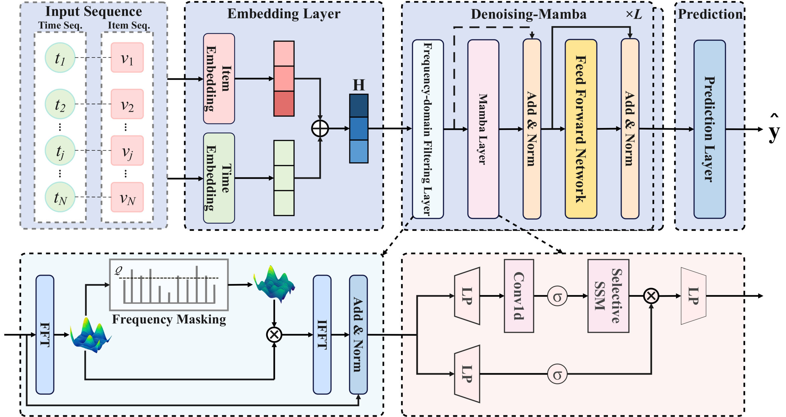
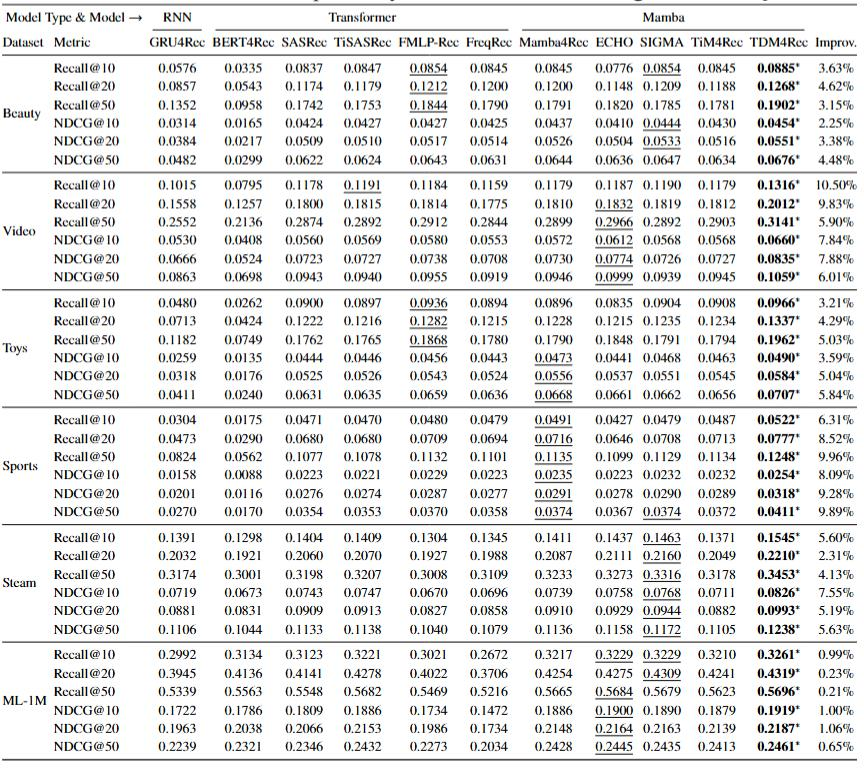
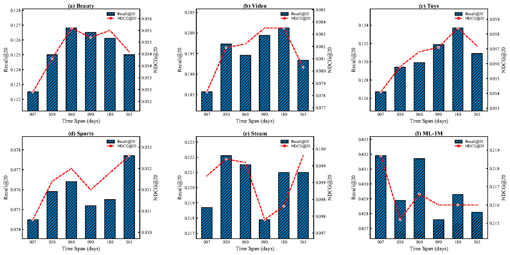
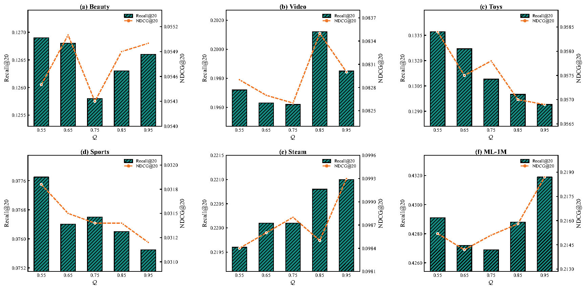

# TDM4Rec

# Overview
TDM4Rec is a Mamba-based architecture, TDM4Rec first integrates item and time sequence embeddings to construct time-aware interaction sequence representations through the embedding layer. These representations are then processed by $L$ stacked Denoising-Mamba layers, each consisting of a frequency-domain filtering layer, a Mamba layer, and a feed-forward network (FFN). Finally, the prediction layer generates recommendation scores for candidate items.




# Datasets
We utilize six benchmark datasets to evaluate TDM4Rec, all of which are obtained from [RecBole](https://github.com/RUCAIBox/RecSysDatasets).
* Amazon Beauty, Video, Toys and Sports are four representative sub-datasets acquired from the [Amazon platform](https://jmcauley.ucsd.edu/data/amazon/), which includes abundant user interaction records. These datasets are characterized by relatively short average interaction sequences.
* Steam is a video game review dataset collected from the online gaming platform Steam.
* ML-1M is a movie rating dataset collected from the [MovieLens website](https://grouplens.org/datasets/movielens/), characterized by relatively long user-movie rating interaction sequences.

All dataset files can be obtained from the cloud storage [BaiDu Cloud Drive (Password: e272)](https://pan.baidu.com/s/1p51sWMgVFbAaHQmL4aD_-g#list/path=%2F).


# Baselines
We compare TDM4Rec with several representative baseline methods, which are briefly introduced below:

* GRU4Rec: captures sequential dependencies in interaction sequences by leveraging GRU.

* BERT4Rec: acquires global context by implementing a bi-directional Transformer under the paradigm of BERT. 

* SASRec: extracts sequential characteristics relying on a unidirectional Transformer.

* TiSASRec: the first method to incorporate temporal information into Transformer-based SR by constructing a time difference matrix and integrating it into the attention mechanism.

* FMLP-Rec: refines sequence representation via learnable filters, which is the pioneer exploration of frequency-based filtering technique in SR.

* FreqRec: jointly captures intra- and inter-sequential dynamics by integrating a learnable frequency-domain MLP with self-attention, and further improves performance by incorporating a frequency-domain consistency loss. 

* Mamba4Rec: captures sequential dependencies via the selective SSM for efficient sequence modeling, which is the first exploration of Mamba architecture in SR.

* ECHOMamba4Rec: employs bi-directional Mamba to enhance global modeling with frequency-domain filtering technique.

* SIGMA: strengthens global and short-sequence modeling by adopting a specific bi-directional Mamba coupled with variant GRU.

* TiM4Rec: incorporates temporal information into Mamba through a time-aware structured masked matrix while preserving linear computational complexity.


# Environment Setting
 ```
conda create -n TDM4Rec python=3.8
conda activate TDM4Rec
 ```
The required environment settings are detailed in the `requirements.txt` file.


# Quick-Start
## How to run
Just run it directly：
 ```
python main.py  
 ```

Example for Beauty
 ```
config = Config(model=FDM4Rec, config_file_list=['config/config.yaml'])
 ```

# Overall Performance
We illustrate the performance of our TDM4Rec comparing with ten state-of-the-art baselines on six datasets. The best performance methods are in boldface, and the second best methods are underlined. $^*$ denotes the improvement is significant with $p$ -value < 0.05.



**(1) TDM4Rec's Advantages.** TDM4Rec jointly incorporates time-awareness and frequency-domain filtering to address insufficient modeling of time-aware item transitions and susceptibility to noisy interactions. Specifically, time sequence embeddings provide explicit temporal context for Mamba to better model time-aware item transitions and capture evolving user preferences. Meanwhile, the proposed Denoising-Mamba module combines frequency-domain filtering with denoised residual connections to suppress potential high-frequency noise and reduce noise propagation during sequence modeling. These designs enable TDM4Rec to learn more accurate and robust user preference representations, contributing to its superior recommendation performance.

**(2) Performance Analysis.** As shown in the Table above, TDM4Rec consistently achieves the best recommendation performance across all six datasets and evaluation metrics. Notably, it achieves larger improvements on Video and Sports, with Recall@10 increasing by 10.50\% and 6.31\%, and NDCG@10 by 7.84\% and 8.09\%, respectively. On Beauty, Toys, and Steam, TDM4Rec also consistently outperforms the strongest baselines, demonstrating the effectiveness of combining temporal context with frequency-domain filtering. In contrast, the improvements on ML-1M are relatively modest, with Recall@10 increasing by 0.99\% and NDCG@10 remaining competitive with the strongest baseline. This difference may be related to dataset characteristics, as ML-1M contains substantially longer and denser interaction sequences than the other datasets. Overall, these results demonstrate that TDM4Rec achieves competitive or superior recommendation performance across diverse sequential recommendation scenarios, highlighting the effectiveness of its time-aware modeling and denoising mechanisms.

# Hyperparameter Sensitivity Analysis
To investigate the impact of key hyperparameters on TDM4Rec, we conduct sensitivity analyses on the time scale $\mathcal{D}$ and the ratio $\mathcal{Q}$. Specifically, $\mathcal{D}$ controls the granularity of temporal partitioning in the time sequence embedding, providing temporal context for Mamba to model item transitions, while $\mathcal{Q}$ determines the frequency threshold for retaining low-frequency components in the frequency-domain filtering layer. We vary $\mathcal{D}$ over ${7, 30, 60, 90, 180, 365}$ days and $\mathcal{Q}$ over ${0.55, 0.65, 0.75, 0.85, 0.95}$.

 
As shown in the figure above, different datasets exhibit varying sensitivity to $\mathcal{D}$. On Beauty, Video, and Toys, the recommendation performance generally increases initially and then decreases as $\mathcal{D}$ increases, with the best performance achieved at $\mathcal{D}=60$ for Beauty and $\mathcal{D}=180$ for both Video and Toys. In contrast, Sports achieves the best performance at $\mathcal{D}=365$, while Steam exhibits some fluctuations across different time scales. ML-1M achieves the best performance at $\mathcal{D}=7$. These results indicate that different datasets benefit from different temporal partitioning scales. Selecting an appropriate time scale provides Mamba with suitable temporal context to better model item transitions, thereby improving recommendation performance.


As shown in the figure above, different datasets also exhibit varying sensitivity to $\mathcal{Q}$. The performance on Beauty remains relatively stable across different ratios, while Video achieves the best performance at $\mathcal{Q}=0.85$. Toys and Sports achieve the best performance at $\mathcal{Q}=0.55$, whereas Steam and ML-1M perform best at $\mathcal{Q}=0.95$. These results indicate that the optimal degree of low-frequency retention varies across datasets. A smaller $\mathcal{Q}$ suppresses more high-frequency components but may discard useful preference information, whereas a larger $\mathcal{Q}$ retains more information but may also preserve potential high-frequency noise. Therefore, selecting an appropriate $\mathcal{Q}$ helps Denoising-Mamba balance noise suppression and preference information preservation, thereby improving recommendation performance.


## Acknowledgements
Our code implementation is based on the [RecBole](https://github.com/RUCAIBox/RecBole) and [Pytorch](https://github.com/pytorch/pytorch) frameworks.
